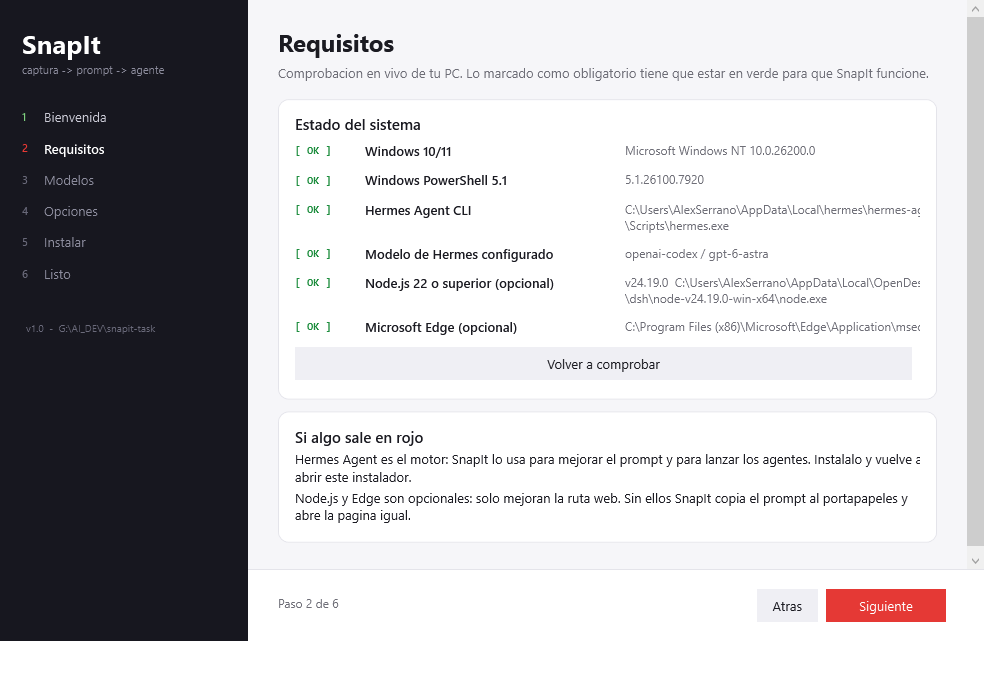
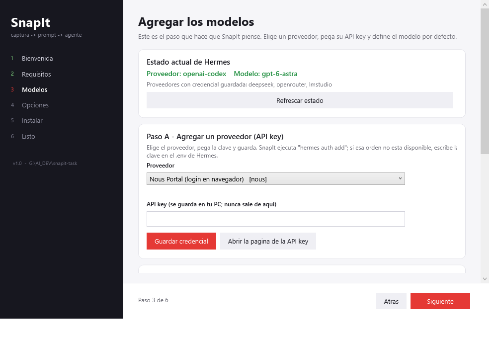

# SnapIt 📸 — capture → improved prompt → execute where YOU choose

A Windows behavior that works exactly like your beloved **Win+Shift+S**, but with
one extra dimension: after you select, mark and finish, SnapIt opens a picker with
two big emojis so you decide **where that capture becomes an executed task**.

```
Alt+Shift+S
   │  fullscreen snipping overlay (like Win+Shift+S)
   │  tools remembered across uses: 🖱️ pointer · 🅃 text · ▭ square · ◯ circle
   │  Enter / ✓  → PNG saved + copied (parity with Win+Shift+S)
   ▼
🔮 Hermes improves & rewrites your intent into one sharp prompt
   ▼
  ┌─────────────────────────────────────────────┐
  │       💻 TERMINAL            🐋 DEEPSEEK    │   ← 2 big emojis
  └─────────────────────────────────────────────┘
   💻 → configured Hermes harness → that agent runs LIVE in Wave
   AUTO → `camarita` classifies the capture → chosen harness runs in Wave
   🐋 → choose a configured web endpoint (DSH included by default)
        already in the composer — NOT submitted, you review & send
```

## Quick start

### 1. Graphical installer (recommended)

Double-click **`Instalar SnapIt.cmd`** in the repository root (no admin rights
needed), or run:

```powershell
powershell -NoProfile -ExecutionPolicy Bypass -File .\installer\SnapIt-Setup.ps1
```

The wizard walks through six steps:

1. **Bienvenida** — what SnapIt does.
2. **Requisitos** — live check of every prerequisite, colour-coded.
3. **Modelos** — **add your model providers here**: pick a provider from the list,
   paste its API key, or log in with Nous Portal; then set the default
   provider/model and press *Probar ahora* to confirm the model really answers.
4. **Opciones** — autostart, hotkey, web destination, agent autonomy, optional
   ElevenLabs voice.
5. **Instalar** — writes the config, runs `setup.ps1`, streams the log.
6. **Listo** — launches SnapIt.

Step 3 is the one that matters: SnapIt sends your screenshot to the model, so the
default model must be **multimodal**. Every provider id, environment variable and
recommended vision model is listed in **[docs/MODELOS.md](docs/MODELOS.md)**.

| Requirements | Add your models |
|---|---|
|  |  |

> Sin interfaz / headless or scripted install:
> `powershell -NoProfile -ExecutionPolicy Bypass -File .\installer\SnapIt-Setup.ps1 -Unattended -AutoStart`

### 2. Manual install

```powershell
git clone <repo-url> snapit-task
cd snapit-task
hermes model                                                              # provider + model + key
powershell -NoProfile -ExecutionPolicy Bypass -File .\setup.ps1           # one-time
powershell -NoProfile -ExecutionPolicy Bypass -File .\snapit.ps1          # run (tray)
```

Full walkthrough, verification commands and uninstall steps:
**[docs/INSTALACION.md](docs/INSTALACION.md)**.

## Why this exists / how the pieces talk

| Piece | Role |
|---|---|
| `snapit.ps1` | Windows PowerShell 5.1 + WPF host: global hotkey, fullscreen snipping overlay with pointer/text/rect/circle tools, last-used-tool memory, big-emoji chooser, orchestration. No installs, single process, tray icon. |
| `lib/snapit-hermes.ps1` | Hermes glue: discovers profiles + emojis, runs the prompt-improver (`hermes -p default chat -Q -q … --image …`), launches executors in visible terminals. |
| `lib/snapit-prefill.mjs` | Zero-dependency Node (≥22) + Edge DevTools Protocol: opens a dedicated Edge window at `http://127.0.0.1:18080`, focuses the composer and places the improved prompt there with **no submit**. |
| `setup.ps1` | One-time setup: creates data folders, writes `config.json`, **clones the Hermes profile `snapit` from `default`** and writes its SOUL (the agent that understands this workflow). |
| `hermes/snapit-soul.md` | Persona/operating rules injected into the cloned `snapit` Hermes profile. |
| `installer/SnapIt-Setup.ps1` | **Graphical installer** (WPF wizard): checks requirements live, walks you through adding model providers + API keys, writes the config, runs setup and launches SnapIt. |
| `docs/INSTALACION.md` | Step-by-step install guide in Spanish, including the model procedure and uninstall. |
| `docs/MODELOS.md` | Provider ids, API-key environment variables, vision-capable models, local models, troubleshooting. |

## Requirements

| Requirement | Needed? | Why |
|---|---|---|
| Windows 10/11 | **Yes** | WPF UI + global hotkeys. |
| Windows PowerShell 5.1 | **Yes** | Ships with Windows; SnapIt is PS 5.1 compatible. |
| [Hermes Agent](https://github.com/NousResearch/hermes-agent) CLI | **Yes** | Improves the prompt and runs the dispatched agents. |
| A **vision-capable model** configured in Hermes | **Yes** | SnapIt sends your capture as an image. See [docs/MODELOS.md](docs/MODELOS.md). |
| Node.js ≥ 22 | Optional | Only for auto-pasting the prompt into the web route; otherwise the prompt goes to the clipboard. |
| Microsoft Edge | Optional | Only for the isolated web-destination window. |

No administrator rights are required: everything lives under `%USERPROFILE%\.snapit`
and `%LOCALAPPDATA%\hermes`.

## setup.ps1 (what the installer runs for you)

```powershell
# run from the repository root, wherever you cloned it
powershell -NoProfile -ExecutionPolicy Bypass -File .\setup.ps1        # one-time
powershell -NoProfile -ExecutionPolicy Bypass -File .\snapit.ps1       # run (tray)
```

`setup.ps1` does NOT auto-start anything on login by default. To start with Windows,
run setup again with `-AutoStart`.

Quick single-flow test (capture once and exit):

```powershell
powershell -NoProfile -ExecutionPolicy Bypass -File .\snapit.ps1 -Once
```

Open the administration panel directly:

```powershell
powershell -NoProfile -ExecutionPolicy Bypass -File .\snapit.ps1 -Admin
```

It is also available from the tray menu as **Admin panel - routes, endpoints,
harnesses**. The panel supports adding, editing, enabling/disabling, and deleting
web endpoints and Hermes harness aliases.

First run creates `C:\Users\<you>\.snapit\config.json` with the defaults below
(emojis per profile included).

## Using it

1. Press **Alt+Shift+S** anywhere.
2. Drag a region (or full area). The toolbar remembers the **last tool used**
   (`pointer`, `text`, `square`, `circle`) — it stays stable across captures.
   - 🖱️ **pointer** → click inside the region to stamp a pointer mark (👆 "here").
   - 🅃 **text** → click and type your note (your words are the highest-priority signal).
   - ▭ / ◯ → drag to frame what matters.
3. Press **Enter** (or ✓). The PNG is saved and copied — just like Win+Shift+S.
4. SnapIt asks Hermes to read the image and rewrite your intent into one clear
   prompt (🔮 while it thinks; the box is editable and copyable).
5. Pick the destination:
   - **💻 Terminal** → enabled harnesses from the Admin panel. Click one → that
     Hermes profile runs the task in a visible Wave block as the active agent.
   - **AUTO** → `camarita` receives the screenshot only as a routing classifier,
     returns one enabled harness profile, and SnapIt launches that profile in Wave.
     If routing fails or returns an unknown profile, SnapIt falls back to manual.
   - **🐋 Web** → choose one enabled endpoint. The selected URL opens in a dedicated Edge
     window with the improved prompt already sitting in the composer. **Nothing is
     submitted** — review, edit, and send when you are ready. If the auto-paste
     bridge can't attach, the prompt is copied to your clipboard and the page is
     opened anyway.

### Ultra Focus (`Alt+Shift+A`)

Press **Alt+Shift+A** to open the full-screen writing panel without taking a
capture. In addition to improving, dispatching, and starting a voice call, the
panel now supports:

- **Save to Draft** — stores the trimmed prompt plus selected Hermes profile as
  JSON under `~\.snapit\drafts\`. Saved drafts appear immediately in the **Drafts**
  sidebar, where they can be loaded (or double-clicked) to continue editing and
  deleted with confirmation.
- **Schedule Task** — asks for a Hermes schedule (`30m`, `every 2h`, a five-field
  cron expression, or an ISO date/time) and an optional name, then creates the
  job for the selected profile with local delivery.

## The cloned Hermes profile (`snapit`)

`setup.ps1` runs `hermes profile create snapit --clone-from default` (idempotent)
and then writes a purpose-built `SOUL.md` plus role description, so the `snapit`
agent appears in the 💻 grid as the executor that *understands this workflow*:
reads captures (rect/circle/pointer marks + your text notes), executes grounded on
what is actually visible, keeps changes safe/reversible, and reports in your
language. It inherits the `default` profile model/credentials/skills because it is
a clone.

## Configuration (`~\.snapit\config.json`, created on first run)

```jsonc
{
  "hotkey": "Alt+Shift+S",          // which global hotkey arms the snipper
  "improvePrompt": true,            // run the 🔮 improver after every capture
  "improverProfile": "default",     // Hermes profile used for the improver
  "improverModel": "",              // optional: force model for the improver
  "executorAutoApprove": true,      // pass --yolo + --accept-hooks to executors
  "executorAutoResume": true,       // after one-shot completion, resume interactively in Wave
  "executorWindow": true,           // run executors in a visible console window
  "executorWorkdir": "profile",     // "profile" = that profile's workspace dir
  "terminalHost": "wave",           // visible executor host; PowerShell is fallback
  "routingMode": "ask",             // "ask" or "auto"
  "autoRouterProfile": "camarita",  // classifier used when routingMode is auto
  "endpoints": [
    {"id":"dsh-local","name":"DeepSeek DSH","url":"http://127.0.0.1:18080","enabled":true}
  ],
  "harnesses": [
    {"id":"unifi-ops","name":"UniFi operations","profile":"unifi-ops","enabled":true}
  ],
  "lastTool": "square",             // remembered tool: pointer|text|square|circle
  "toolColor": "#E53935",
  "toolThickness": 4,
  "textFontSize": 30,
  "webUrl": "http://127.0.0.1:18080",// DeepSeek 🐋 target
  "profileEmojis": {
    "default": "◆", "g-master-switch": "🎮", "kimi-intel": "🧠",
    "spotifycanvas": "🎨", "unifi-ops": "📡", "snapit": "📸"
  }
}
```

> ⚠️ `executorAutoApprove: true` means dispatched Hermes agents run without asking
> for dangerous-command approval (same spirit as your existing headless ops). Turn
> it off if you prefer the agents to ask before acting.

With `executorAutoResume: true`, SnapIt replaces Hermes' generic resume hint with
the profile-aware form `hermes -p <profile> chat --resume <id> -q '<nuevo prompt>'
--yolo --accept-hooks`, then automatically opens that session interactively in the
same Wave block (without `-q`, so the completed task is not submitted twice).

## Layout

```
<wherever you cloned it>\
├── Instalar SnapIt.cmd     # double-click launcher for the graphical installer
├── installer\
│   └── SnapIt-Setup.ps1    # WPF wizard: requirements + models + install
├── snapit.ps1              # the app (tray + hotkey + snipping + chooser)
├── snapit-watchdog.ps1     # relaunches the tray app after a hard kill
├── setup.ps1               # one-time install / profile clone / autostart
├── lib\
│   ├── snapit-hermes.ps1   # Hermes glue (dot-sourced by snapit.ps1)
│   ├── snapit-prefill.mjs  # Edge CDP prefill for the Web UI route
│   ├── voice-flow.ps1      # voice event -> improved prompt -> dispatch
│   └── camarita-bridge.py  # optional local bridge for voice events
├── hermes\
│   └── snapit-soul.md      # SOUL.md content for the cloned `snapit` profile
├── voice\                  # local ElevenLabs signed-URL server + client
├── tests\                  # PowerShell contract/regression suite
├── docs\
│   ├── INSTALACION.md      # install guide (Spanish)
│   └── MODELOS.md          # providers, API keys, vision models
└── README.md
```

Run the whole test suite from the repository root:

```powershell
Get-ChildItem tests\*.ps1 | ForEach-Object { & powershell.exe -NoProfile -ExecutionPolicy Bypass -File $_.FullName }
```

Runtime data: `~\.snapit\` → `captures\*.png`, `jobs\<ts>\` (improved prompt +
dispatch text + logs), `config.json`, `resume.json` (pending dispatch checkpoint),
`restart.json` (auto-restart crash guard), `.exit` (watchdog stop marker).

## Crash resilience & persistence

SnapIt is built to **stay alive and not lose your work**:

- **Capture flow can no longer crash it.** A text note + Enter used to call a WPF
  method that does not exist (`TextBox.ClearFocus()`), aborting the whole capture.
  It now clears focus with `Keyboard.ClearFocus()` - Enter commits your note, Enter
  again finishes the capture, exactly as intended.
- **One error never kills the tray.** `Start-SnapitFlow`, the focus panel and every
  UI callback run under guarded error paths, and the tray registers a dispatcher
  safety net: an unhandled UI exception is logged and swallowed instead of taking
  the app down.
- **Auto-restart.** If the tray app ever ends unexpectedly (crash, killed process),
  it relaunches itself in a fresh process. A crash guard (`restart.json`) stops the
  loop if it crashes 4+ times in 30 seconds. When launched from `Startup\SnapIt.cmd`
  (autostart watchdog), `snapit-watchdog.ps1` additionally relaunches it on hard
  kills. Choosing **Exit SnapIt** from the tray writes `~\.snapit\.exit` so the
  watchdog stops instead of relaunching.
- **Pending work survives a crash.** While a capture is waiting for its destination,
  SnapIt checkpoints it to `~\.snapit\resume.json` (capture image + prompt). If the
  session dies before dispatch, the next start asks: *re-open it*, *discard it*, or
  *keep it* (not asked again that session). Re-opening goes straight to the
  destination picker - the capture and improved prompt are not lost.

## Troubleshooting

- **Hotkey doesn't fire** → another app owns Alt+Shift+S; change `hotkey` or close it.
- **Improver takes too long / fails** → capture still finishes; SnapIt falls back to
  a plain instruction and you can still pick a destination. Check
  `hermes -p default chat -Q -q "hi"` works from a terminal.
- **DeepSeek prefill opens a second Edge** → intended: a dedicated isolated Edge
  profile (`%TEMP%\snapit-edge-*`) is used so your normal browser is untouched.
- **The improved prompt is empty or generic** → your default model cannot see
  images. See [docs/MODELOS.md](docs/MODELOS.md).
- **Installation problems** → `%USERPROFILE%\.snapit\logs\install.log` (installer) and
  `%USERPROFILE%\.snapit\logs\snapit.log` (app). Full guide:
  [docs/INSTALACION.md](docs/INSTALACION.md).
- Emojis per profile are cosmetic — edit `profileEmojis` in `config.json`.

## Voice bridge (optional)

`Alt+Shift+A` can open a spoken call whose transcript is improved and then dispatched
to a Hermes agent or the web route. It needs an ElevenLabs account:

1. Put your key in the Hermes `.env` (the installer's **Voz** card does this):
   `ELEVENLABS_API_KEY=...`
2. Set your agent id in `~\.snapit\config.json`:
   `"voiceAgentId": "agent_xxxxxxxx"` (the installer's **Voz** card writes it too).
3. `lib\camarita-bridge.py` is an **optional** local event bridge for voice
   hardware/automation. It does nothing unless you run it, and it now binds to
   `127.0.0.1` by default. Copy `voice-config.example.json` to
   `%USERPROFILE%\.snapit\voice-config.json` and fill in your own tokens.

## License

MIT — see [LICENSE](LICENSE).
